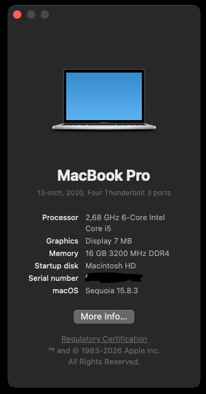
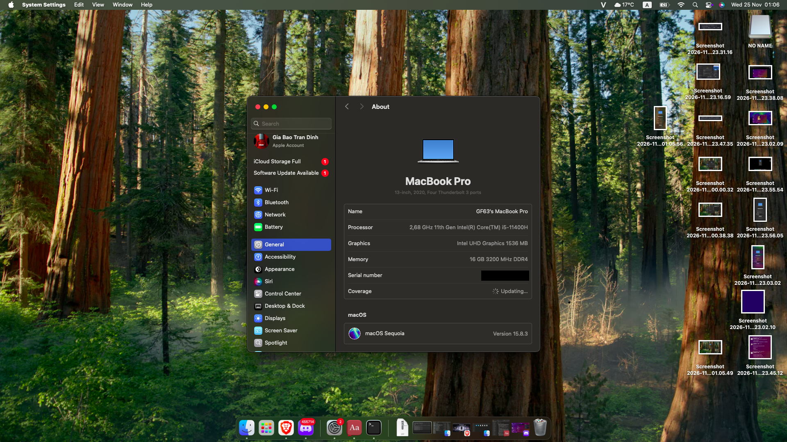

<h1 align="center">MSI GF63 11SC Hackintosh</h1>

<p align="center">
  OpenCore EFI for the MSI GF63 Thin 11SC running macOS Sequoia
</p>

<p align="center">
  
  
  
</p>

<p align="center">
  
</p>

---

> [!WARNING]
> **This project is a work in progress.**
> It is currently waiting for the [WhateverXe](https://github.com/b00t0x/WhateverXe) developer to fix a bug affecting H45 (Tiger Lake-H) CPUs.
> The laptop *can* be used as a daily driver, but it is **not recommended** until the bug is fixed.

> [!NOTE]
> **About updates:** this project is developed entirely in my spare time. When a new version of WhateverXe is released, I may not be able to update this EFI right away, since I mostly use my phone. Updates may take longer than expected.

## 📑 Table of Contents

- [Supported macOS](#-supported-macos)
- [Specifications](#-specifications)
- [Status](#-status)
- [BIOS Settings](#️-bios-settings)
- [Installation](#-installation)
- [How to Fix](#%EF%B8%8F-how-to-fix)
- [Kexts & SSDTs](#-kexts--ssdts)
- [Known Issues](#-known-issues)
- [Disclaimer](#-disclaimer)
- [Credits](#-credits)

## 💻 Supported macOS

| Version | Status |
|---|---|
| macOS Sequoia 15.8.3 | ⚠️ Tested (WIP) |
| macOS Tahoe 26.x | ❓ Not tested |

> [!NOTE]
> This EFI is only tested on **macOS 15.8.3**. macOS 26.x has not been tested yet.
> If it gets tested, a separate EFI for it will be uploaded.

## 📋 Specifications

| Component | Details |
|---|---|
| Laptop | MSI GF63 Thin 11SC (664VN) |
| CPU | Intel Core i5-11400H @ 2.70 GHz (6 cores / 12 threads) |
| iGPU | Intel UHD Graphics, Tiger Lake-H45 (8086:9A60) |
| dGPU | NVIDIA GeForce GTX 1650 Max-Q |
| RAM | 16 GB (2x8 GB) DDR4 3200 MHz |
| Wi-Fi / Bluetooth | Intel AX201 (Wi-Fi 6 / Bluetooth 5.2, 160 MHz) |
| Storage | Kingston OM8PDP3512B-AI1 (512 GB, PCIe Gen 3 x4 NVMe) |
| Storage (secondary) | Kingston SA400S37120G (120 GB, SATA 3) |
| Install layout | macOS on a 120 GB partition of the NVMe drive, dual boot with Windows (shared 100 MB EFI partition) |

> [!NOTE]
> This EFI is only tested on the hardware above. Different RAM, Wi-Fi cards, SSDs or BIOS versions may behave differently.
>
> The macOS partition shows up as "Primary Partition" in Windows Disk Management because Windows can't read APFS. Do not format it.

## ✅ Status

| Feature | Status | Notes |
|---|---|---|
| Boot macOS | ✅ | Occasional freezes during use |
| Intel UHD graphics | ✅ | 1536 MB, using the WhateverXe 9A60 fork |
| Wi-Fi | ✅ | Works great |
| Bluetooth | ✅ | Works great with headphone, accessories |
| Audio | ⚠️ | Internal Speakers have no sound. Try one of the 3 Line Out outputs (the last one may work) |
| Microphone | ❌ | Unsupported or no kext available |
| Touchpad | ✅ | Gestures work too, but you need a careful touch for them to register |
| Keyboard / Fn keys | ✅ | Keyboard and Fn keys work |
| Webcam | ❌ | Unsupported or no kext available |
| Sleep / Wake | ❌ | Not working yet |
| NVIDIA GTX 1650 | ❌ | Not supported by macOS |

> ✅ works, ⚠️ partially works, ❌ not working, ❓ not tested.

<details>
<summary>📸 Screenshots</summary>

<p align="center">
  
</p>

</details>

## ⚙️ BIOS Settings

Some required options (such as **CFG Lock** and **DVMT Pre-Allocated**) are hidden by default on MSI laptops.
To unlock the hidden advanced menu, press this combination while in the BIOS setup:

```
Right Ctrl + Right Shift + Left Alt + F2
```

| Setting | Value | Path |
|---|---|---|
| Secure Boot | Disabled | `Security` → `Secure Boot Support` |
| CFG Lock | Disabled | `Advanced` → `Power & Performance` → `CPU - Power Management Control` → `CPU Lock Configuration` → `CFG Lock` |
| DVMT Pre-Allocated | 96M | `Advanced` → `System Agent (SA) Configuration` → `Graphics Configuration` → `DVMT Pre-Allocated` |
| Fast Boot | Disabled | `Boot` → `Fast Boot` |
| VT-d | Enabled | `Advanced` → `VT-d` or `Advanced` → `System Agent (SA) Configuration` → `VT-d` |

<details>
<summary>Secure Boot (Disabled)</summary>

1. Go to `Security` → `Secure Boot Support`.
2. Set it to **Disabled**.

</details>

<details>
<summary>CFG Lock (Disabled)</summary>

> [!IMPORTANT]
> Requires the hidden advanced menu. Unlock it first with `Right Ctrl + Right Shift + Left Alt + F2`.

1. Go to `Advanced` → `Power & Performance` → `CPU - Power Management Control`.
2. Open `CPU Lock Configuration` (it is the last item in the list).
3. Set `CFG Lock` to **Disabled**.

</details>

<details>
<summary>DVMT Pre-Allocated (96M)</summary>

> [!NOTE]
> This option is hidden by default. Unlock the hidden advanced menu first.

1. Go to `Advanced` → `System Agent (SA) Configuration` → `Graphics Configuration`.
2. Set `DVMT Pre-Allocated` to **96M** (64M also works, but 96M is recommended).

</details>

<details>
<summary>Fast Boot (Disabled)</summary>

1. Go to `Boot` → `Fast Boot`.
2. Set it to **Disabled**.

</details>

<details>
<summary>VT-d (Enabled)</summary>

1. Go to `Advanced` → `VT-d` and set it to **Enabled**.
2. If you can't find it there, go to `Advanced` → `System Agent (SA) Configuration` → `VT-d` and set it to **Enabled**.

</details>

## 🚀 Installation

This is a prebuilt EFI, free to use, for anyone who doesn't want to build their own.

1. Download the EFI from the **Releases** page.
2. Create a macOS installer USB by following the [Dortania OpenCore Install Guide](https://dortania.github.io/OpenCore-Install-Guide/). Download macOS directly from Apple.
3. Copy the `EFI` folder to the EFI partition of the USB drive.
4. **Set up your own SMBIOS.** All `PlatformInfo` / SMBIOS values in this EFI (Serial, MLB, SmUUID, ROM) are **zeros (placeholders)**. Do not boot with them as they are:
   1. Generate your own values with [GenSMBIOS](https://github.com/corpnewt/GenSMBIOS).
   2. Check the generated serial (make sure it is not already in use).
   3. Put the values in `config.plist` under `PlatformInfo` → `Generic`.
5. Apply the [BIOS settings](#️-bios-settings) above, boot from the USB and install macOS.
6. After installing, follow [Booting Without USB](booting-without-usb.md) to copy the EFI to your internal drive. Otherwise you will still need the USB to boot.

> [!IMPORTANT]
> Back up your data before installing.

## 🛠️ How to Fix

### The laptop only boots with the USB / the BIOS doesn't show OpenCore

After installing macOS, the EFI is usually not copied to the internal drive, so the BIOS has nothing to boot.

👉 Follow the guide: **[Booting Without USB](booting-without-usb.md)**

It covers how to:

- copy the `EFI` folder to the internal drive's EFI partition
- add a boot entry using the UEFI Shell (OpenShell)
- set the new entry as the first boot option in the BIOS

### Other problems

**WIP**

## 📦 Kexts & SSDTs

<details>
<summary>Kext list</summary>

**Core**
- Lilu 1.7.2
- VirtualSMC 1.3.0 (with SMCProcessor, SMCSuperIO, SMCBatteryManager, SMCLightSensor)
- WhateverXe 0.8.4
- AMFIAnchor 0.1.2
- AMFIAnchorInjector 1.0.0
- RestrictEvents 1.1.7
- ECEnabler 1.0.6
- NVMeFix 1.1.4

**Audio**
- AppleALC 1.7.7

**Wi-Fi & Bluetooth**
- AirportItlwm 2.4.0 (macOS 15 / Sequoia only)
- IntelBluetoothFirmware 2.5.0
- IntelBTPatcher 2.5.0
- BlueToolFixup 2.7.3

**Input**
- VoodooPS2Controller 2.3.8 (Keyboard, Mouse, Trackpad)
- VoodooI2C 2.9.1 (with VoodooI2CServices, VoodooGPIO, VoodooInput 1.1.7)
- VoodooI2CHID
- BrightnessKeys 1.0.4

**USB**
- USBToolBox 1.2.0
- UTBMap
- XHCI-unsupported 0.9.2

**Network**
- RealtekRTL8111 2.4.2

</details>

<details>
<summary>SSDT list</summary>

- SSDT-PLUG (CPU power management)
- SSDT-PNLF (backlight)
- SSDT-Disable_GPU_PEG1 (disables the NVIDIA GPU)
- SSDT-GPI0 (GPIO, for the I2C touchpad)
- SSDT-XOSI (Windows OS interface, for the I2C touchpad)
- SSDT-ALS0 (ambient light sensor)
- SSDT-SBUS (SMBus)
- SSDT-MCHC (memory controller)
- SSDT-RTCAWAC (RTC fix)
- SSDT-USBX (USB power)
- SSDT-USB-Reset (USB port reset)

</details>

## 🐛 Known Issues

- Waiting on the WhateverXe fix for H45 CPUs
- macOS 26.x is untested with this EFI
- Installing `WhateverXe.pkg` can break booting
- ...

## 📜 Disclaimer

- This EFI is provided **as-is, without any warranty**. Use it at your own risk.
- It is free and not affiliated with Apple, MSI, or any of the projects listed in the credits.
- Apple's macOS installer is **not** included. Download it from Apple.
- Every kext and tool keeps its own license. See the linked repositories for details.

## 🙏 Credits

- [OpCore Simplify](https://github.com/lzhoang2801/OpCore-Simplify) by lzhoang2801, used to generate the base EFI, then tweaked by hand
- [Acidanthera](https://github.com/acidanthera) for OpenCore and the kexts
- [b00t0x](https://github.com/b00t0x/WhateverXe) for WhateverXe
- [Dortania](https://dortania.github.io/OpenCore-Install-Guide/) for the install guide
- ...

## 📄 License

MIT
